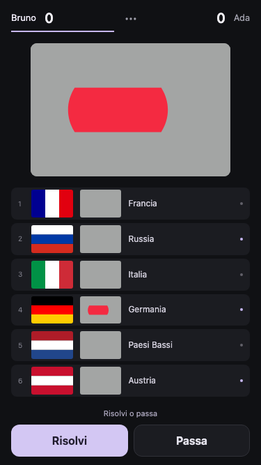

# Flag Duel

Un duello di bandiere per due giocatori. Scegli una bandiera-sonda, scopri le zone con colori simili e prova a indovinare quella segreta prima dell’avversario.

**195 Paesi · stanze private · nessun account · nessun timer · mani illimitate**



## Avvio rapido su Mac o Linux

Richiede **Node.js 24 LTS o successivo** e npm.

```sh
git clone https://github.com/OrturanoLabs/flagduel.git
cd flagduel
npm ci
npm run build
npm start
```

Apri **http://localhost:8080**. Il server ascolta su `0.0.0.0:8080`: da un altro dispositivo in LAN/VPN apri `http://IP_DEL_SERVER:8080`. Per due giocatori sullo stesso Mac usa browser/profili distinti oppure una finestra privata.

Per limitare l’accesso al solo computer locale:

```sh
HOST=127.0.0.1 npm start
```

La prima build elabora gli asset locali; le successive riusano la cache se sorgenti e motore non sono cambiati. Non vengono scaricate bandiere durante il gioco.

## Come si gioca

1. Crea una stanza e condividi il codice di tre caratteri o il link.
2. L’avversario entra; **solo il creatore può avviare**.
3. A turno scegli una sonda: entrambi vedete le intersezioni delle zone geometriche con colori abbastanza simili. Gli indizi si accumulano.
4. Dopo la sonda scegli **Risolvi** oppure **Passa**. La risposta definitiva parte subito, senza un secondo dialogo: se è errata, il punto va all’avversario. Una sonda con il codice Paese esatto vince immediatamente.
5. Dopo la mano entrambi scelgono **Prossima mano**. Il primo giocatore si alterna e il punteggio continua finché volete giocare.

Ci sono sei sonde distinte per mano; dopo la sesta si può ancora risolvere, mentre Passa termina la mano in pareggio. Nessun timeout. Il menu centrale permette di uscire dalla stanza.

Nel campo Paese, **primo Invio seleziona il risultato migliore, secondo Invio invia**. Il selettore mostra solo i nomi; la cronologia mostra le sonde già giocate e le regioni trovate. L’interfaccia obsidian è pensata per smartphone, senza scroll della pagina di gioco.

## Sviluppo

```sh
npm ci
npm run dev
```

Apri `http://localhost:5173`. Vite è locale e inoltra API e Socket.IO al backend sulla porta 8080. In produzione Express serve frontend e realtime sulla stessa porta: non esporre Vite come server di produzione.

Il laboratorio SVG è disponibile nel menu solo in sviluppo. Gli endpoint `/api/lab` e `/api/report` non sono registrati in produzione.

## Docker su server Linux

```sh
cp .env.example .env
# In .env imposta BIND_ADDRESS all’IP VPN del server.
# Il valore predefinito 127.0.0.1 consente accesso solo locale.
docker compose up --build -d
docker compose logs -f app
```

Apri `http://IP_VPN_DEL_SERVER:8080`. Il container ascolta su `0.0.0.0:8080`; la porta host è configurabile con `PORT`. Health endpoint: `GET /health`.

```sh
docker compose down
docker compose up --build -d
```

Il prototipo usa HTTP e una VPN già configurata; non serve HTTPS. HTTP non aggiunge TLS. Non inoltrare la porta sul router e verifica la raggiungibilità effettiva e le regole Docker/firewall. I dettagli sono in [docs/deployment.md](docs/deployment.md).

Configurazione: `BIND_ADDRESS`, `PORT`, `TOLERANCE=0.04`, `MAX_PROBES=6`. Senza Docker, esporta le variabili nella shell: Node non legge automaticamente `.env`.

## Test

```sh
npm run typecheck
npm test
npm run build
npx playwright install chromium
npm run test:e2e
```

Vitest verifica colori, geometria, corpus, regole e Socket.IO. Playwright prova due smartphone separati, tutte le azioni fino a sette mani, refresh, tastiera e layout; un secondo scenario confronta visivamente tutti i 195 SVG con il rendering delle superfici preprocessate. La porta 8080 deve essere libera durante gli E2E.

Esiti e limiti delle prove: [docs/verification.md](docs/verification.md). Docker/Linux e due computer fisici in VPN devono essere verificati sull’ambiente di destinazione.

## Architettura e limiti

TypeScript strict, React/Vite/Tailwind, Express/Socket.IO e Zod. Il motore usa Skia PathOps via CanvasKit WASM e Paper.js per **intersezioni vettoriali reali**, con confronto sRGB → OKLab e soglia ΔEOK inclusiva. Nessun confronto raster nella logica di gioco.

```text
apps/web/              interfaccia e laboratorio
apps/server/           server autoritativo e macchina a stati
packages/shared/       protocollo e validazione
packages/flag-engine/  SVG, geometria e OKLab
assets/                sorgenti, licenze, catalogo e report
scripts/               preprocessamento e avvisi di licenza
tests/ e e2e/          test automatici
```

Il catalogo comprende 193 membri ONU e due osservatori, Santa Sede/Vaticano e Palestina. **176 SVG sono dettagliati e 19 sono varianti grafiche semplificate**, dichiarate nel [report](assets/generated/report.json). Il Nepal mantiene trasparente l’esterno della sagoma. Le bandiere visivamente indistinguibili restano giocabili e la vittoria dipende dal codice Paese.

Stanze e sessioni sono in memoria, in una sola istanza Node: **un riavvio azzera le partite**. Il rientro guest ripristina identità e ruolo tramite token locale; le stanze interamente disconnesse scadono dopo un’ora. Non sono implementati account, persistenza, matchmaking o classifica globale.

Dettagli del motore e precisione: [docs/vector-engine.md](docs/vector-engine.md).

## Licenza e attribuzioni

Il codice originale di Flag Duel è disponibile sotto **[licenza MIT](LICENSE)**: è consentito usarlo, modificarlo e ridistribuirlo, anche commercialmente, mantenendo gli avvisi richiesti.

Le bandiere e le librerie conservano le loro licenze. Le principali fonti degli SVG sono [flag-icons](https://github.com/lipis/flag-icons) e [country-flag-icons](https://github.com/catamphetamine/country-flag-icons), entrambe MIT. I copyright e i testi originali sono conservati nel repository, nella build web e nel container.

- [Attribuzioni e indice delle licenze](THIRD_PARTY_NOTICES.md)
- [Testi integrali di copyright e licenze](third_party/THIRD_PARTY_LICENSES.txt)
- [Fonti degli asset, del catalogo e del metodo](docs/sources.md)

Una citazione o un link aiutano a rintracciare la fonte, ma **non sostituiscono i testi di licenza e gli avvisi di copyright richiesti**. Gli avvisi distribuiti si rigenerano con `npm run licenses` e sono inclusi anche su `/THIRD_PARTY_LICENSES.txt` nell’app avviata.
